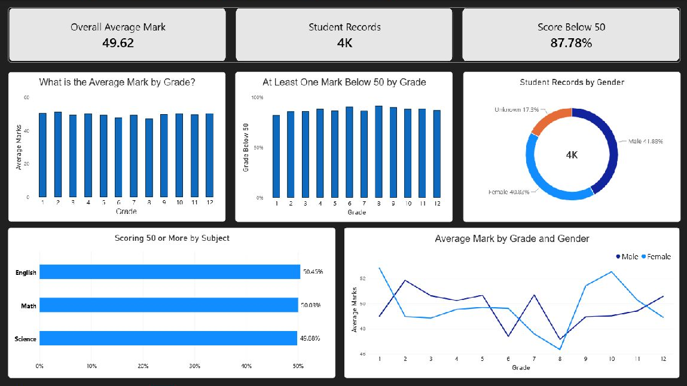
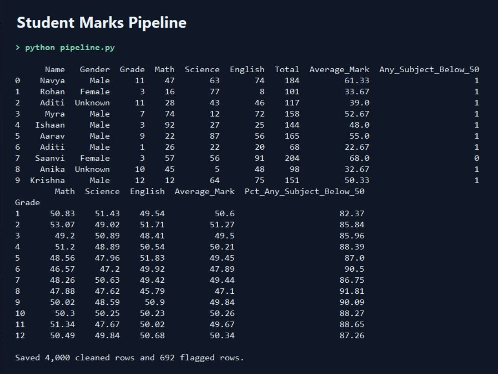

# Data Pipeline

I built a Python data pipeline and a Power BI dashboard to understand how students performed in Math, Science, and English. I started with four messy CSV files from Kaggle and turned them into a clean dataset, a separate file for records that needed review, and a dashboard I can refresh after rerunning the pipeline.

**4,000 student records · 12 grades · 3 subjects**



[Open the Power BI report file](pipline%20Dashboard.pbix) · [See the Python code](pipeline.py)

## Dataset

I downloaded the [Messy Student Marks Dataset – Practice Data Cleaning](https://www.kaggle.com/datasets/vedikagupta0/messy-student-marks-dataset-data-cleaning-practice) by Vedika Gupta from Kaggle. The dataset contains simulated student records designed for data cleaning practice. The four original files are in [`data/raw`](data/raw), with the [dataset license notice](data/raw/LICENSE.txt).

Only the first CSV had a header. I kept that header once and appended every data row from parts 2–4, including their first rows. The combined input had **4,000 rows and 7 columns**. The cleaned output has **4,000 rows and 9 columns** because I added two calculated fields.

## How I built the pipeline

| Step | What I did | What I got |
| --- | --- | --- |
| **Extract** | I used `pd.read_csv()` to load the combined CSV as text so formats like `08` were available for cleaning. | One pandas DataFrame with the raw records. |
| **Clean** | I checked for exact duplicates, removed whitespace and extra punctuation, standardized names and gender labels, and converted grades and scores to whole numbers. I checked grades against 1–12, subject marks against 0–100, and verified the recorded total against the sum of the three marks. | Consistent fields and a separate file for blanks, invalid values, total mismatches, or unmapped codes. |
| **Transform** | I added `Average_Mark` across the three subjects and `Any_Subject_Below_50`, a 1/0 flag for having at least one mark below 50. Both calculations require all three marks. | Two fields I could use directly in Power BI. |
| **Analyze** | I used `groupby("Grade")` to calculate subject averages, overall averages, and the percentage of records with at least one mark below 50 for each grade. | A 12-grade summary printed by Python. |
| **Load** | I used `to_csv()` to save the cleaned data and error log. Then I loaded the cleaned CSV into Power BI Desktop. | A dashboard-ready CSV and a separate review file. |
| **Run the pipeline** | I put the steps inside `run_pipeline()` and called it under `if __name__ == "__main__":`. | One command runs the full workflow in order and regenerates both CSVs. |

### Before and after cleaning

| Field | Raw example | Cleaned result |
| --- | --- | --- |
| Name | `'Vihaan'` | `Vihaan` |
| Gender | `M`, `male`, `m` | `Male` |
| Gender | `0` or `1` | `Unknown`, with the original code in the error log |
| Grade | `08`, `Grade 12` | `8`, `12` |
| Marks | `20 marks`, `23.0` | `20`, `23` |

For example, marks of **92, 27, and 25** add up to **144** and give an average of **48.00**. The below-50 flag is **1** because at least one subject mark is below 50. I used 50 as a benchmark for this analysis.

### Python output

The script prints the first 10 cleaned rows, the grade summary, and the final row counts. All **692 flags** in this dataset came from the unmapped gender codes.



## What the dashboard showed me

I built five visuals and three overview cards in Power BI. The cards show the record count, overall average mark, and share with at least one mark below 50. The charts show grade averages, the below-50 share by grade, the gender breakdown, the three-subject comparison, and average marks by grade and gender.

- The **overall average mark was 49.62**. Grade 2 had the highest average (**51.27**) and Grade 8 had the lowest (**47.10**).
- **3,511 of 4,000 records (87.78%)** had at least one mark below 50. The share was highest in Grade 8 (**91.81%**) and lowest in Grade 1 (**82.37%**).
- **English** had the most marks at or above 50 (**2,018 of 4,000**, or **50.45%**). Math had **2,001** and Science had **1,995**. The difference between English and Science was only **23 records**.
- The overall averages for the known gender labels were close (**49.70 for Female** and **49.61 for Male**). The line chart helped me see where the gap changed by grade. The donut includes the **692 Unknown records (17.3%)**, and the line chart compares the two known groups.

### Power Query and DAX

I created a separate `Subject Marks` query and unpivoted Math, Science, and English. That gave me `Subject` and `Mark` columns for a single horizontal bar chart. The chart tooltip shows the average mark for each subject.

I used these DAX functions to turn the cleaned fields into report measures.

| Measure | DAX functions | What it does |
| --- | --- | --- |
| `Student Records` | `COUNTROWS` | Counts the records in the current filter context. |
| `Overall Average Mark` | `AVERAGE` | Averages `Average_Mark` for the records in view. |
| `Share Below 50` | `AVERAGE` | Averages the 1/0 flag to get the share with at least one mark below 50. |
| `Share Scoring 50 or More` | `CALCULATE`, `COUNT`, `KEEPFILTERS`, `DIVIDE` | Counts marks at or above 50 within the current filters and divides by the number of recorded marks. |

## What I learned

- How to break a Python pipeline into functions that I can run together or reuse separately.
- Why it helps to load messy data as text, validate values before converting them, and keep an error log alongside the cleaned data.
- How to create useful columns with pandas and use `groupby()` to compare grades.
- How to check Power BI visuals against my Python results, use Power Query to reshape columns, and write DAX measures that respond to filters.

## Run the project

From the repository folder, run these commands using Python 3.12 or later.

```bash
python -m pip install -r requirements.txt
python pipeline.py
```

The script reads [`student_data_combined.csv`](student_data_combined.csv) and regenerates [`student_data_cleaned.csv`](student_data_cleaned.csv) and [`student_data_cleaning_errors.csv`](student_data_cleaning_errors.csv).

Open the [PBIX file](pipline%20Dashboard.pbix) in Power BI Desktop to explore the report. To refresh it on your computer, point the CSV source in **Data source settings** to your local copy of `student_data_cleaned.csv`, then select **Refresh**.
